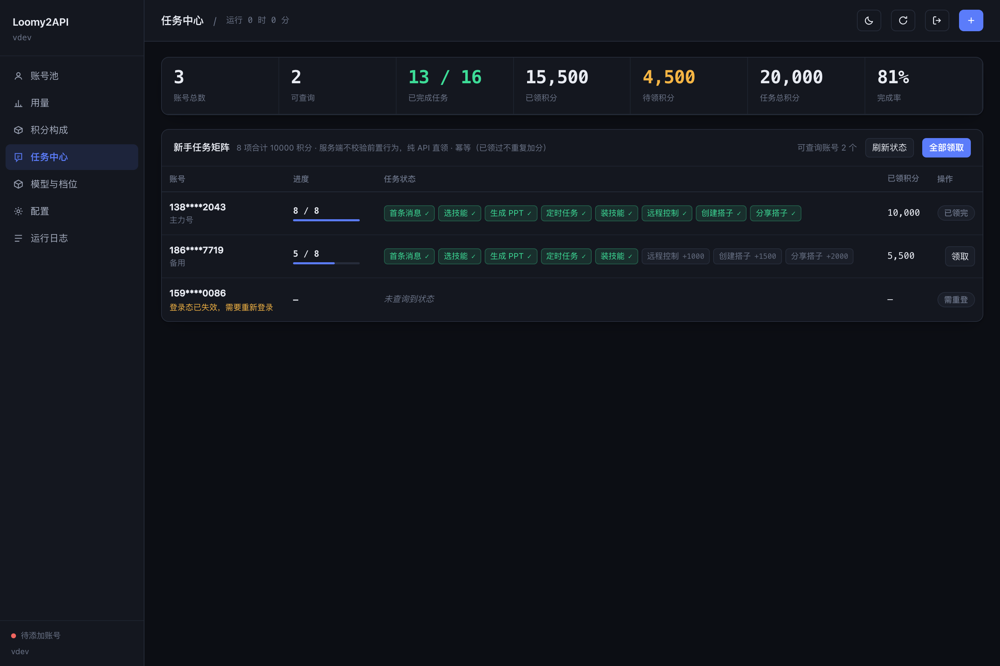

<p align="center">
  <h1 align="center">Loomy2API Panel</h1>
</p>

<p align="center">
  <b>把讯飞 Loomy 账号变成 OpenAI / Anthropic 兼容 API 的多账号网关 · 附 Web 管理面板</b><br>
  密码自动登录 · 账号池轮转 · 熔断与冷却 · 会话粘性 · 双协议 · 流式 / 非流式 · 单二进制 · 零第三方依赖
</p>

<p align="center">
  
  
  
  
</p>

---

> [!NOTE]
> **维护方式披露**：本项目的协议事实来自对官方 Loomy 桌面客户端（Electron `0.9.38`）的抓包分析
> 与同族公开实现，**与讯飞无任何关联，也未获授权**。上游随时可能收紧，通道稳定性不保证；
> 因使用非官方客户端导致的账号风控 / 封禁，由使用者自行承担。

> [!WARNING]
> **本项目仅限本人授权账号、本机 / 私有环境自用。**
> 禁止批量小号、代充、卡密售卖、对外中转站或任何形式的收费分发。详见[使用声明](#使用声明必读)。

## 使用声明（必读）

本项目的开发初衷只有一个：**方便个人管理自己的 Loomy 账号**——自动领取每日额度、自动续登，
并给自己的本地工具提供一个 OpenAI / Anthropic 兼容入口。它是免费、开源、按「原样」提供的个人自用工具。

如果你打算用它做下面这些事，请现在就关掉这个页面：

- 批量注册小号、收购账号，对外提供付费 API、共享池或代充；
- 二次加壳、捆绑卡密售卖，或以「公益服」「低价中转」名义变相收费；
- 把他人账号的额度转卖，或任何违反上游服务条款的用途。

作者不授权、不支持、不参与上述行为，由此产生的一切后果由行为人自行承担。
`auths/` 里保存的是**明文手机号与密码**——任何第三方打包版本都可能回传你的凭证，
**你付钱买到的不是本项目，而是把自己的账号交给陌生人。**

## 项目简介

Loomy2API 是一个自托管的**反向代理网关**，把讯飞 Loomy（`loomyad.xunfei.cn`）的账号
包装成统一的、兼容 OpenAI 与 Anthropic 双协议的 API 服务。

- 官方不提供 OpenAI 形态的开放 API。本项目通过**手机号 + 密码服务端登录**拿到登录态
  （`session`），并用它作为上游 Bearer token；
- 面向**个人多账号**场景：多号共享、单号故障自动换号、冷却 / 熔断防雪崩、会话粘性保证多轮不跳号；
- 对客户端暴露 `chat_completions`、`codex_responses` 与 `anthropic_messages`，
  模型名按上游目录归一（精确匹配优先，其次最长前缀）；图像模型自动分道到 `/v1/images/generations`。

协议细节（签名算法、登录信封、模型目录口径、积分结算）见 **[docs/PROTOCOL.md](docs/PROTOCOL.md)**。

## 核心能力

| 能力 | 说明 |
|---|---|
| 🔑 **密码自动登录** | 存手机号 + 密码，网关自己走 RSA + HMAC-SHA1 签名登录；登录态剩余不足阈值时**后台自动重登**，14 天有效期滚动续上（上游无 refresh token；纯 session 卡密号无法续期） |
| 📅 **每日额度自动领取** | 复刻官方客户端启动即调的 `points/first-login`（幂等领每日 5000）：登录成功、定时刷新、面板按钮三条链路都会触发 |
| 🎁 **新手任务直领** | 上游 8 项新手任务合计 **10000 积分**，服务端**不校验前置行为**，纯 API 直领、零 token 消耗；面板「任务中心」展示账号 × 任务矩阵 |
| 🚫 **失效模型台账** | 上游对下架模型回 404，与账号无关。网关记成**模型级**台账（30 天 TTL），期间 `/v1/models` 隐藏、请求直接 404，**不罚账号** |
| 🔒 **严格模型校验** | Loomy 对认不出的模型名**不报错**，而是静默用默认模型执行并回 200（实测 `no-such-model-xyz` → 响应 `model` 变成 `DeepSeek-V4.1-Flash`，按默认模型扣分）。网关在目录层直接 404，客户端拿不到「成功的错答案」 |
| 🧩 **模型名别名** | 请求名先归一成目录里的标准 id：**精确匹配优先**，否则取**最长前缀**（`deepseek-v4.1-flash-xxx` → `DeepSeek-V4.1-Flash`）。前缀后必须是分隔符，拼错的名字（`spark-xylophone`）仍 404，并在文案里提示最接近的模型 |
| 🆓 **限免与倍率识别** | 上游 `/models` 没有结构化倍率字段，倍率与「限时免费」都写在展示名里（`Spark-X2.6-preview(限时免费)(x0.0)`），网关解析后由面板渲染「限免」标签 |
| 🖼️ **图像模型多端点** | `type=image` 的模型支持 `/v1/images/generations`、`/v1/images/edits`（multipart / JSON），也可走 `/v1/chat/completions` 与 `/v1/responses` 前门（自动折成 prompt + 参考图），支持单图与**多图数组** |
| 🪄 **生图模型自动归并** | 生图端点（`generations` / `edits`）先精确匹配目录，未命中再按**家族前缀**找同族图像模型（`doubao-seedream-4-0-250828` → `doubao-seedream-5-lite`、`qwen-image-2.5` → `qwen-image-3.0-pro`，同族取版本最高），最后才用 `image_fallback_model` 兜底。对话端点仍严格 404，不会把拼错的对话模型变成一次生图 |
| 🧹 **生图 400 自动精简** | 客户端把 Seedream 4.5 / 新版生图参数原样发来时（`stream`、`sequential_image_generation`、`watermark`、`seed`、`n>1`），下游 provider 会回「请求有误」；网关自动去掉非核心字段重试，仍失败再退到 `model/prompt/image(images)/size`（参考图字段始终保留），并把被丢字段写进日志 |
| 🔄 **多账号池** | 余额加权 + 成本分层 + 加权随机选号，Top-5 候选 + 防惊群；**每日赠送额度优先**（按自然日清零的那份先花） |
| 🛡️ **熔断与冷却** | 429 软冷却指数退避（封顶可配）、404 短冷却、额度耗尽硬冷却到次日 00:00、连败熔断、单号在途租约 |
| 🧲 **会话粘性** | 同一会话绑定同一账号，TTL 滚动续期，失败自动解绑；用**最后一条 user 消息**派生会话键，多轮对话不会永久锁死单号 |
| ⚡ **双协议三端点** | OpenAI `chat/completions` + `responses`，Anthropic `messages`（流式、工具调用、思考链全支持） |
| 🧠 **思考链透传** | 上游 `reasoning_content` → Anthropic `thinking` 块 / Responses `reasoning` 项，不静默丢弃 |
| 🕐 **长任务不掐断** | 非流式长请求内部转流式取数再聚合，绕开上游约 60s 的 504 |
| 📊 **可观测** | 每请求一行表格日志（TTFB / token 速率）、`/status`、`/healthz`、`/metrics`、请求台账落盘 |
| 💾 **状态持久化** | 池状态原子落盘（含额度快照：积分 / 每日周期 / 签到状态重启不丢）；用量台账 JSONL 追加 |
| 🖥️ **Web 管理面板** | 内嵌单页（明暗主题、手机抽屉导航），七个视图：账号池 / 用量 / 积分构成 / 任务中心 / 模型与档位 / 配置 / 运行日志 |
| 📦 **零依赖** | 全部标准库，`go build` 即可，无 cgo、无 npm、无外部构建步骤 |

## Web 管理面板

`http://127.0.0.1:17890/panel/`，用配置里的 `api_keys` 进入（与 `/v1/*` 同一把钥匙）。

<p align="center">
  
  <br><sub>任务中心 · 深色主题（示例数据）</sub>
</p>

| 视图 | 内容 |
|---|---|
| **账号池** | 健康色条 / 积分量条 / 冷却倒计时；登录、签到、刷新额度、暂停选号、禁用、移除、备注；积分到期提醒（按自然日聚合，日均需耗 = 该日到期 ÷ 距到期天数） |
| **用量** | KPI + SVG 时序图；按账号 / 按模型两个维度、四档时间窗；小时级 token 与积分对照 |
| **积分构成** | 每日赠送（次日周期到期）与长期积分（不到期）拆开；来源包明细 + 邀请码 |
| **任务中心** | 账号 × 8 项新手任务的矩阵；完成态、已领积分、待领积分；单号 / 全量领取（幂等） |
| **模型与档位** | 目录来自上游 `/models`（失败回落内置表）；倍率、限免标签、上下文长度、思考档位、图像模型标记；条件筛选与排序 |
| **配置** | 在线修改 `config.json`，保存后**热生效**；`listen` / `auth_dir` / `state_file` / `upstream` 等装配期字段标注「需重启」 |
| **运行日志** | 请求记录（含来源 IP / UA，可关）、错误汇总、积分历史；按时间区间与关键字筛选 |

设计口径与 `workbuddy2api` 面板一致：冷石墨底色 + 单一靛蓝强调色，语义色只给状态；
观测值统一等宽数字 + `tabular-nums`；三态主题（跟随系统 → 浅色 → 深色）在样式表之前预热，刷新不闪屏；
严格 CSP（`default-src 'none'`、无内联脚本）、`X-Frame-Options: DENY`、`Referrer-Policy: no-referrer`。

## 快速开始

### 方式一：直接跑二进制

```bash
go build -o loomy2api ./cmd/server

# 首次会自动生成 config.json，并在日志里打印随机 api_key
./loomy2api -config config.json
```

打开 `http://127.0.0.1:17890/panel/`，填入日志里的 `api_key`，
在「账号池 → 添加账号」填手机号与密码，保存即会自动登录、签到、领新手任务。

### 方式二：Docker

```bash
docker compose up -d
docker compose logs -f    # 看首启生成的 api_key
```

`config.json`、`auths/`、`data/`（池状态 + 用量台账）都在挂载卷里，重建容器不丢。

### 方式三：GHCR 镜像

```bash
docker run -d --name loomy2api -p 17890:17890 \
  -v "$PWD/data:/data" \
  ghcr.io/rsfree/loomy2api:latest
```

### 客户端接入

```bash
# OpenAI 兼容客户端
export OPENAI_BASE_URL=http://127.0.0.1:17890/v1
export OPENAI_API_KEY=<config.json 里的 api_keys[0]>

curl $OPENAI_BASE_URL/chat/completions \
  -H "Authorization: Bearer $OPENAI_API_KEY" \
  -H 'Content-Type: application/json' \
  -d '{"model":"imodel/spark-x","messages":[{"role":"user","content":"你好"}],"stream":true}'
```

```bash
# Claude Code 等 Anthropic 客户端
export ANTHROPIC_BASE_URL=http://127.0.0.1:17890
export ANTHROPIC_AUTH_TOKEN=$OPENAI_API_KEY

curl $ANTHROPIC_BASE_URL/v1/messages \
  -H "x-api-key: $ANTHROPIC_AUTH_TOKEN" \
  -H 'anthropic-version: 2023-06-01' \
  -H 'Content-Type: application/json' \
  -d '{"model":"imodel/spark-x","max_tokens":1024,"messages":[{"role":"user","content":"你好"}]}'
```

```bash
# Codex / Responses API
curl http://127.0.0.1:17890/v1/responses \
  -H "Authorization: Bearer $OPENAI_API_KEY" \
  -H 'Content-Type: application/json' \
  -d '{"model":"imodel/spark-x","input":"你好"}'
```

## 端点一览

| 方法 | 路径 | 协议 | 说明 |
|---|---|---|---|
| POST | `/v1/chat/completions` | OpenAI | 主对话端点（也接受无 `/v1` 前缀） |
| POST | `/v1/responses` | OpenAI Responses | Codex 等客户端 |
| POST | `/v1/messages` | Anthropic | Claude Code 等（也接受 `/messages`） |
| GET | `/v1/models` | OpenAI | 模型目录（上游优先，失败回落内置表）；图像模型带 `endpoint` / `supports_chat=false` |
| POST | `/v1/embeddings` | OpenAI | 向量 |
| POST | `/v1/images/generations` | OpenAI | 生图 / 图生图；参考图接受 `image` 与 `images`，**多图 = `images` 数组**（上限 4 张，超限截尾并回 `X-Loomy-Image-Warn`） |
| POST | `/v1/images/edits` | OpenAI | 同上，multipart 前门（`image` / `image[]` / `images[]` 文件、`mask`） |
| POST | `/v1/search` | — | 内置联网检索通道 |
| GET | `/v1/points` | — | 全池额度 |
| GET | `/status` | — | 账号池状态（需鉴权） |
| GET | `/healthz` | — | 健康检查（有可用账号 200，否则 503；带 `service` 标识） |
| GET | `/metrics` | Prometheus | 指标文本（需鉴权） |
| GET | `/panel/` | — | Web 管理面板 |
| GET | `/panel/api/onboarding` | — | 任务中心矩阵（每号查一次 `/onboarding/tasks`） |
| POST | `/panel/api/accounts/{name}/onboarding` | — | 单号领新手任务（幂等） |
| POST | `/panel/api/onboarding_all` | — | 全池领新手任务 |
| POST | `/panel/api/accounts/{name}/checkin` · `/checkin_all` | — | 单号 / 全量签到（`first-login`，幂等） |
| GET | `/panel/api/dead_models` · `POST /dead_models/{model}/clear` | — | 失效模型台账与手动解除 |
| POST | `/panel/api/accounts/{name}/pause` · `/resume` · `/disable` · `/revive` | — | 暂停选号 / 恢复 / 禁用 / 解冻 |
| GET | `/panel/api/packages` · `/credit_history` | — | 积分构成与流水 |
| POST | `/panel/api/sms/send` · `/sms/login` | — | 短信验证码登录 |

鉴权同时接受 `Authorization: Bearer <key>` 与 `x-api-key: <key>`。

### 生图：参考图字段的真实形态

**多图走 `images`（复数）数组**，不是 `image`。这就是官方客户端 0.9.38 的图生图请求体
（`electron/image/image-generation-service.js`，配套单测逐字节断言过）：

```json
{
  "model": "doubao-seedream-5-lite",
  "prompt": "把这两张图合成一张海报",
  "images": ["https://example.com/product.png", "data:image/png;base64,iVBORw0..."],
  "n": 1,
  "size": "2304x1728",
  "response_format": "url"
}
```

- 数组元素可以是 URL、data URI，**两者可混用**；
- 前端上传上限 **4 张**（main bundle 常量 `Cu=4`，超出提示「最多上传 4 张图片」）；
- 顺序即提示词里的「第一张 / 第二张」，网关只截尾、不重排。

网关两种字段都收，转发前统一收敛成上游认识的形态：

| 客户端传 | 发给上游 | 说明 |
|---|---|---|
| `"image": "url"` | `"image": "url"` | 单图，2026-10-22 实测有效（dhash≈1，NCC≈0.998） |
| `"images": ["a","b"]` | `"images": ["a","b"]` | 与官方客户端一致（单图发数组也行，会压成字符串） |
| `"image": ["a","b"]` | `"images": ["a","b"]` | 旧形态自动升级；上游对 `image` 传数组是静默忽略的 |
| 超过 4 张 | 只发前 4 张 | 响应头 `X-Loomy-Image-Warn: images-truncated-to-4` |
| `"image": null` / `[]` | 两个字段都删 | 明确表示「文生图」（OpenAI SDK 常这么发） |
| `"image": ""` 或数组含空串 | — | **400**：空串是写错了，不是没传图（同 image-adapter） |
| 单张 > 32M 字符 | — | **400**：单张上限（base64 膨胀 4/3，≈24MB 原图） |
| `mask` 但没参考图 | — | **400**：mask 必须搭配 `image` |

参考图元素支持三种形态：远程 URL、`data:image/...;base64,`、裸 base64；
上游按原样接收，网关只做字段与张数收口（校验规则对齐 `image-adapter` 的
`validate_images_body`：字符串或字符串数组、`null`/`[]` 视为没有图、空串拒绝、
单张 32M 字符上限、`mask` 依赖 `image`）。

`/v1/images/edits` 的 multipart 前门同理：`image` / `image[]` / `images[]` 文件按 part
顺序转 data URI，再进同一个数组；空 part 视同没传。

对话前门（`/v1/chat/completions`、`/v1/responses`）认三种图片块拼法——
`image_url` / `input_image` / `image`，值可以是字符串，也可以是 `{"url": "..."}`。

### 端点 / 形态矩阵（2026-10-23 线上实测，9 次出图各 110 积分）

测试图：参考 A = 品红圆形，参考 B = 青绿色方形；提示词**不描述颜色与形状**，
再用像素统计核对输出，只有两种颜色同时出现才算「第二张真的生效」。

| 端点 | 请求形态 | 结果 | 第二张是否生效 |
|---|---|---|---|
| `/v1/images/generations` | `image` 字符串（1 张） | 200 | 未适用（单图语义） |
| `/v1/images/generations` | `image` 数组（2 张） | 200 | **生效** |
| `/v1/images/generations` | `images` 数组（2 张） | 200 | **生效** |
| `/v1/images/generations` | `images` 数组（1 张） | 200 | 未适用（单图语义） |
| `/v1/images/edits`（JSON） | `image` 数组（2 张） | 200 | **生效** |
| `/v1/images/edits`（multipart） | `image[]` 两个文件 | 200 | **生效** |
| `/v1/chat/completions` | 2 个 `image_url` 内容块 | 200 | **生效** |
| `/v1/responses` | 2 个 `input_image` 内容块 | 200 | **生效** |
| `/v1/images/generations` | `qwen-image-3.0-pro` + `images`（2 张） | 200 | **生效** |
| `/v1/messages` | 图像模型 | 400（指路到 generations，设计如此） | — |

单图用例只出现品红、没有青绿，说明「单图语义」没有被多图污染；多图用例两种颜色
像素占比都在 15%–23%，七个形态全部通过。

```bash
# 多图合成：把两张参考图交给同一个模型
curl http://127.0.0.1:17890/v1/images/generations \
  -H "Authorization: Bearer $OPENAI_API_KEY" \
  -H 'Content-Type: application/json' \
  -d '{"model":"doubao-seedream-5-lite","prompt":"把第一张图的产品放进第二张图的场景里",
       "images":["https://example.com/product.png","https://example.com/room.jpg"]}'
```

> ⚠️ 历史坑：2026-10-22 曾拿 `image` 传数组做实测，`["a","b"]` 全部退化成纯文生图
> （出无关人脸，各扣 110 分），据此写下「上游没有多图能力」。**结论错在字段名**——
> 上游读的是复数 `images`；单数 `image` 只认字符串。
>
> ✅ 2026-10-23 复验（3 次实跑）：两张互不相似的参考图（红圆 + 蓝方）在**一次请求**里
> 同时出现在输出中；data URI、HTTPS URL、`size=2848x1600` 三种组合都是 200。
> 多图合成成立，上游会真的读两张。

### 生图另外两个坑（上游都是**静默**处理，不报错）

1. **模型名被静默替换**：目录外的名字（如 `doubao-seedream-5-0-260128`）会按家族前缀回退到同族
   最高版（常见是 `doubao-seedream-5-lite`）。换模型后图生图能力未必还在。回退现在会回显在
   响应头 `X-Loomy-Model-Fallback: <请求名> -> <实际名>`，实际模型见 `X-Loomy-Model`；
   不想被回退就开 `strict_model_check`，让目录外的名字直接 404。
2. **`sequential_image_generation`**：这是组图开关（`auto` + `max_images`），超分 / 保主体这类
   单图图生图场景建议不要带，容易让上游走进「一次出多张」的分支。

## 配置

配置是单个 `config.json`，首次启动自动生成（含 `crypto/rand` 随机 `api_key`）。
所有键也可用环境变量覆盖（`LOOMY_` 前缀，如 `LOOMY_LISTEN`、`LOOMY_API_KEYS`）。
完整注释版见 **[config.example.json](config.example.json)**。

### 常用项

| 键 | 默认 | 说明 |
|---|---|---|
| `listen` | `:17890` | 监听地址（改动需重启） |
| `api_keys` | `[]` | 网关密钥，空 = 不鉴权（**勿暴露公网**） |
| `auth_dir` | `./auths` | 账号凭证目录（改动需重启） |
| `state_file` | `./data/state.json` | 池状态文件（改动需重启） |
| `upstream` | `https://loomyad.xunfei.cn/api/v1` | 上游模型网关（改动需重启） |
| `default_model` | `imodel/deepseek-v4-flash-0731` | 未指定模型时用 |
| `strategy` | `weighted` | `weighted` / `round_robin` / `balance` / `lru` |
| `pick_top_n` | `5` | 加权选号短名单大小 |
| `max_inflight_per_account` | `0` | 单号在途上限（0 = 不限） |
| `balance_floor` | `0` | 积分保底：可用积分 ≤ 此值停止接单（0 = 关闭） |
| `prefer_daily_quota` | `true` | 优先花每日赠送额度，再动长期积分 |
| `strict_model_check` | `true` | 不在目录里的模型直接 404，不打上游（目录匹配支持最长前缀别名） |
| `image_fallback_model` | `doubao-seedream-5-lite` | 生图端点「同族前缀也对不上」时的最后兜底；留空 = 关闭（仍 404） |
| `dead_model_ttl_days` | `30` | 失效模型台账 TTL |
| `sticky_ttl_seconds` | `1800` | 会话粘性 TTL（0 = 关闭） |
| `soft_rate_base_seconds` / `_max_` | `600` / `7200` | 429 软冷却基数与封顶 |
| `breaker_threshold` | `5` | 连败多少次熔断 |
| `keepalive_min_tokens` | `1500` | 非流式长任务阈值（超此值内部转流式） |
| `session_renew_before_days` | `3` | 登录态剩余低于此天数时告警，并触发自动重登 |
| `auto_relogin` | `true` | 有密码的账号到期前自动重登（滚动 14 天）；纯 session 卡密号无效 |
| `max_retries` | `2` | 换号重试次数 |
| `quota_refresh_minutes` | `30` | 后台额度刷新间隔（顺带跨日领每日额度） |
| `proxy` | `""` | 全局出口代理，账号级 `proxy` 可覆盖 |

面板里改配置会区分**热生效**与**需重启**：`listen` / `auth_dir` / `state_file` /
`upstream` / `account_base` / `log_dir` 改动后需重启，其余立即生效。

## 架构

```
cmd/server/           入口：配置 → 账号池 → 上游客户端 → 网关 + 面板 → HTTP
internal/
  account/            账号服务客户端：HMAC-SHA1 签名、RSA 加密、密码 / 短信登录
  upstream/           模型网关客户端（必需头、模型目录、积分、签到、新手任务、检索）
  pool/               账号池：选号 / 冷却 / 熔断 / 粘性 / 在途 / 失效模型台账 / 持久化
  bridge/             Anthropic ↔ OpenAI、Responses ↔ OpenAI 翻译
  server/             HTTP 网关：入站解析、换号重试、SSE 转发/聚合、长任务转流式
  panel/              内嵌管理面板（go:embed）：账号运维、用量、积分、任务中心、配置、日志
  usage/              请求台账（环形缓冲 + JSONL）
  httpauth/           常量时间 Bearer 校验
  config/             配置加载 / 保存 / 脱敏 / 首启生成
docs/PROTOCOL.md      协议事实（签名、登录、模型目录、积分结算、已知坑）
```

### 选号是怎么算的

```
weight = 余额占比 ×10  +  闲置补偿 ×1  +  成功率 ×3
```

取权重 Top-5 组成短名单，再在名单内做加权随机抽签。只取最大值会让单号被打爆，
纯随机又会让低权重号白拿流量，Top-N + 抽签兼顾两者。

**会话粘性用「最后一条 user 消息」派生会话键**——常见客户端每轮重发完整历史，
若用首条 user 派生，键永远不变，粘性会永久锁死同一账号，多账号池直接退化成单账号
（参考实现里实测请求分布 779:13）。取最后一条后，多轮对话每轮键都变，
粘性只对「同一条消息的重试」生效，这正是它该干的事。

### 一次请求的生命周期

```
鉴权 → 模型目录校验（strict）→ 选号（排除冷却 / 熔断 / 在途满 / 积分保底）
     → 上游请求（必需头：Authorization + token + traceparent + loomy-version）
     → 成功：回写积分 / 成功计数，SSE 原样转发（非流式长任务内部转流式聚合）
     → 失败：分类（429 / 404 / 额度 / 登录态 / 其他）→ 冷却或熔断 → 换号重试
```

## 部署

```bash
# 1. 准备配置
cp config.example.json config.json

# 2. 改三处：listen、api_keys、按需 proxy
#    首次启动也会自动生成随机 api_key，但显式写一份更好管理

# 3. 起容器
docker compose up -d
```

- **反向代理**：Nginx / Caddy 必须关闭响应缓冲并放大读超时，否则 SSE 会被攒包或掐断：

  ```nginx
  location / {
      proxy_pass http://127.0.0.1:17890;
      proxy_http_version 1.1;
      proxy_set_header Connection "";
      proxy_buffering off;
      proxy_read_timeout 3600s;
      proxy_send_timeout 3600s;
  }
  ```

- **健康检查**：`/healthz` 在「有可用账号」时 200，否则 503。无账号的新实例在负载均衡里会被判死，
  这是有意为之——它确实还不能接活。
- **权限**：容器以 uid 10001 运行，Linux 宿主挂载目录需 `chown -R 10001:10001 ./data`，
  否则写 `auths/*.json.tmp` 会 permission denied。
- **出口**：真正决定风控画像的是网络出口。`proxy` 支持全局与账号级覆盖；
  账号级优先，适合给不同账号分配不同出口。

### 发版

版本只存在于 git tag，不写回代码。三种入口：

| 触发 | 行为 |
|---|---|
| push `main` | 读最新版本 tag，patch 自增（`v0.0.1 → v0.0.2`），自动打 tag、建 Release |
| push `vX.Y.Z` tag | 人工指定版本（minor / major 用），不递增 |
| Actions → Release → Run workflow | 输入已存在的 tag 补发（镜像或 Release 失败后重跑） |

每次发布产出五平台二进制 + `SHA256SUMS.txt`，以及 `ghcr.io/rsfree/loomy2api` 的
`:<version>` / `:sha-<7位>` 多架构镜像（amd64 + arm64）；只有 main 自增路径会移动 `:latest`。
镜像先本地起容器冒烟，`/healthz` 返回带 `service=loomy2api` 才推送——冒烟不过，GHCR 见不到坏镜像。

commit message 含 `[skip release]` 时只跑测试，不出版本、不推镜像。

## 开发与测试

```bash
make check     # go fmt + go vet + go test + gofmt -l 校验
make cross     # 四平台交叉编译冒烟
make build     # 产出 ./loomy2api
```

测试覆盖：签名与 RSA 往返、选号分布与排他、冷却退避与封顶、熔断、模型级冷却、
积分保底、粘性 TTL 与容量、错误分类、SSE 解析与聚合、Anthropic / Responses 双向翻译
（含工具调用与思考链）、图像模型在对话端点被本地 400 拦住且不打上游、未知模型在目录层 404
且不打上游、404 记模型台账不罚账号（含 TTL 与持久化）、每日赠送额度优先分档、
额度冷却终点为自然日 00:00、新手任务幂等与积分表合计、任务中心矩阵（顺序固定、
不可查询账号不发请求）、配置读写与脱敏、鉴权、面板渲染与安全头、台账落盘与重启恢复。

## 安全与合规

- **凭证存储**：`auths/*.json` 以 0600 权限保存手机号与密码（**明文**）。
  这是「登录态 14 天到期后无人值守自动重登」的必要代价——上游没有 refresh token。
  请确保该目录不在备份 / 同步盘的共享范围内。
- **鉴权**：`api_keys` 为空时 `/v1/*` 与 `/panel/api/*` **完全不鉴权**，仅适合
  `127.0.0.1` 本机或可信内网。放到公网前必须设置 `api_keys`（面板登录与 `/v1/*` 用同一把）。
- **面板**：内嵌页带严格 CSP（`default-src 'none'`、无内联脚本）、`X-Frame-Options: DENY`、
  `Referrer-Policy: no-referrer`；配置视图与账号视图都不回显密钥或完整 session。
- **合规边界**：本项目是个人自用的协议互操作实现，**不得用于贩卖、共享他人账号、
  批量薅取免费额度或任何违反上游条款的用途**。作者不承担使用后果。

## 已知局限

- 没有 refresh token → 登录态到期只能重登，因此需要保存手机号 + 密码；
- `/v1/messages` 是本地翻译层（上游只有 OpenAI 形态），工具调用与思考链已覆盖，
  但 Anthropic 的 `cache_control` 断点无法传递到上游；
- 模型目录以 `/models` 为准；上游不可用时回落到内置表，此时新上架模型需要等上游恢复；
- 每日额度按**自然日 00:00** 重置，与 WorkBuddy 的 04:00 不同，不能互抄冷却终点。

## 血统与致谢

- **主逻辑**来自 [loomy2api-panel](https://github.com/misakano7545/loomy2api-panel)（MIT）：
  账号签名登录、上游客户端、账号池、双协议翻译、面板骨架与协议事实均以其为基线；
- **工程与界面风格**对齐 [workbuddy2api](https://github.com/rsfree/workbuddy2api)（MIT）：
  面板设计令牌、七视图结构、配置热生效口径、仓库与发布形态；
- 本仓在其上做了模块与二进制重命名、任务中心视图、发布工作流与文档重构。
  两处原始版权声明均保留在 [LICENSE](LICENSE) 中。

上游服务为讯飞 Loomy（`loomyad.xunfei.cn`），非官方、未获授权，非本项目上游。

## License

[MIT](LICENSE)
